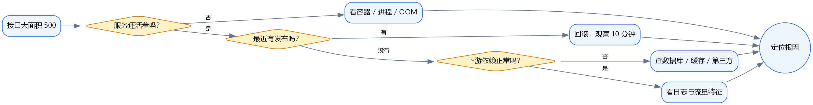
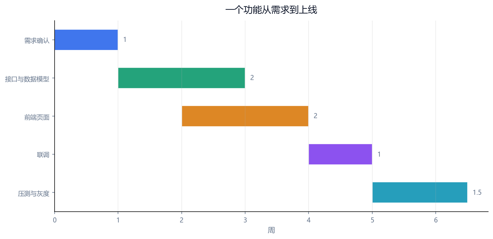
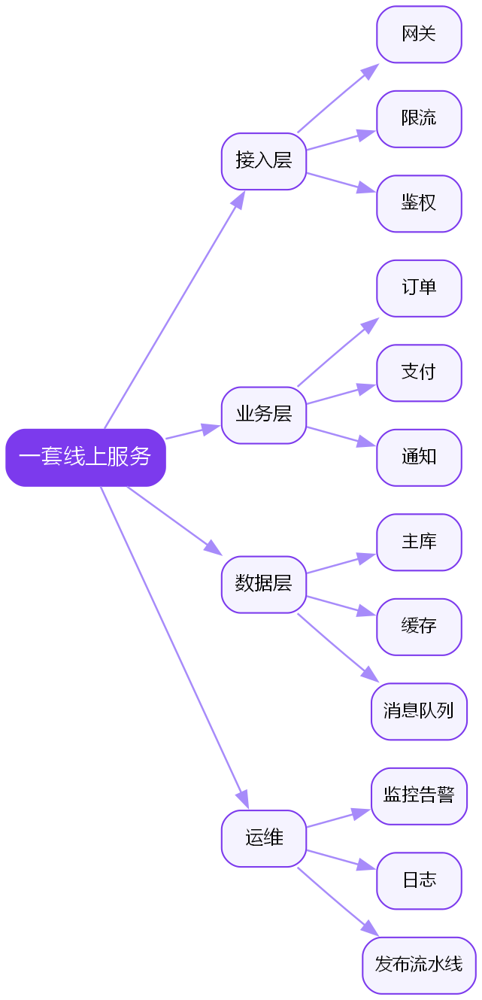
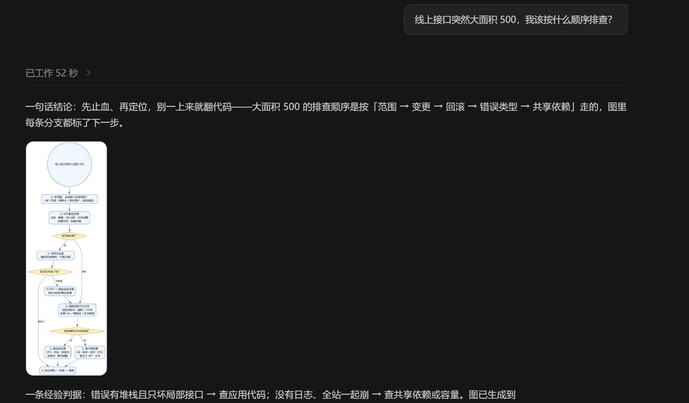
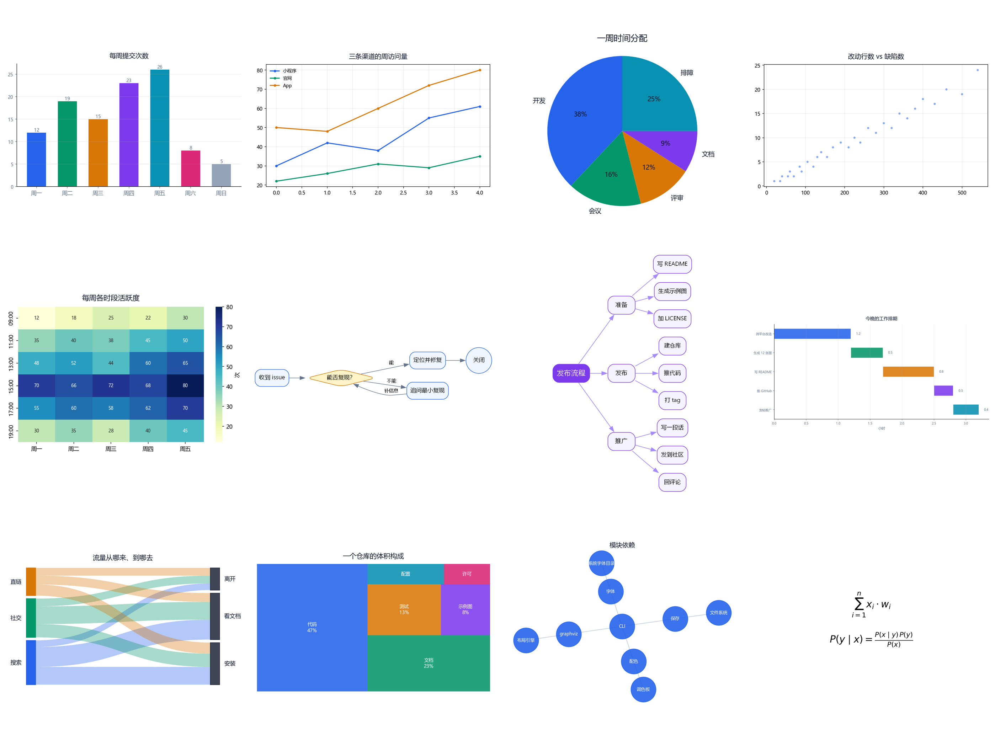

# chart-skill

**English** · [中文](README.zh-CN.md) · [日本語](README.ja.md)

**Same question. Two answers.**


Left: **25 seconds**, seven numbered paragraphs — the reader has to prioritise them.
Right: **28 seconds**, one flowchart — branches, exits and the next step are all on the canvas.

**Nearly the same time.** The difference is what the model decides to do with those three seconds.
It doesn't change what the model *can* do. It changes what it *chooses* to do.

This is an **agent skill**, not a charting library. Drop it into your agent's skill directory and it starts choosing diagrams over paragraphs — with hard rules for both directions: when it *must* draw, and when it *must not*.

---

## What it actually changes

Prose is **linear**: you have to read to the end to know what matters, then rebuild the structure in your head.
A diagram is **parallel**: structure, proportion, flow and order are visible at once.

So the question is never "can this be drawn" but:

> **Is this information already shaped like a diagram?**

If yes, drawing it saves the reader half the work. If no, drawing it is just decoration. This skill encodes both halves — and the second one (restraint) is the part most tools miss.

## What a conversation looks like after installing it

### Triage: five paragraphs → one flowchart

**Before** — the reader has to sort out the priorities:

> This error usually has three causes. First, the port is taken… second, the config path is wrong… third, dependencies are missing… the first is the most common…

**After**:



### Scheduling: "about six weeks" → a gantt you can argue with



### Structure: one breathless sentence → a mind map



---

But the hard part isn't drawing. It's **knowing when not to**.

Three numbers or fewer: use a table. Two sentences: just say it. One or two diagrams per answer, maximum. Those are hard rules in `SKILL.md`, not suggestions — a gate the model has to pass before every reply.

## Install

```bash
git clone https://github.com/jiangmejiang123/chart-skill
pip install -r chart-skill/requirements.txt

# then move the whole directory into your agent's skills folder:
#   Claude Code  → ~/.claude/skills/chart-skill/
#   other agents → their own skills dir (e.g. ~/.dsh/skills/, .agents/skills/ in a project)
```

Open a new session and ask something that needs structure. Watch whether the answer changes shape.

> It reads `SKILL.md` (the judgement rules) + `scripts/` (the renderer).
> Without SKILL.md it's just a chart tool; without the scripts it's just advice. You need both.

## What it depends on (read this before installing)

The skill has **two halves**, and it does nothing if you only install one:

| Half | Lives in | Responsible for |
|---|---|---|
| The skill | `SKILL.md` + `scripts/` | which chart, how to draw it, data formats |
| **The behavioural rule** | **your workspace instructions (AGENTS.md or equivalent)** | **"if you'd write paragraphs, draw it instead"** |

Why the second half can't be skipped: the skill only loads when the description matches.
But "should this be a diagram" is a **per-turn judgement**. With only the skill, the model quietly waits for you to say "draw me a flowchart". With the rule in place, it decides on its own.

### Add this to your AGENTS.md

```markdown
## Draw before you write

One sentence is enough for one conclusion. Comparisons, lists and parameters belong in a table.
Processes, structures and trends belong in a diagram.

**Violation shapes** (any of these means: draw it first, don't write it out):
1. Three or more numbered sections that depend on each other in order;
2. "If X then Y" branching (triage orders, decision trees);
3. Prose enumerating "what comes first", "where it gets stuck", "what it's made of".

A numbered list is not a "list". A numbered list with an order is a flowchart that hasn't been drawn yet.

**Exemption**: steps the user will actually execute — commands to paste, menus to click — stay as a list.
The test is whether a single line can be copied and run as-is.

**Stop after drawing**: don't repeat the diagram in prose underneath it.
```

### Tested: which harnesses honour it

| Harness | Result | Why |
|---|---|---|
| DSH standard preset | Works — diagram on the first question | workspace instructions injected in full every turn |
| ZCode | Works — same | same |
| Minimalist "phase-1 bootstrap" presets (defer the rules, then only hint at a filename) | Fails — plain text throughout | the full text is never injected, the skill catalog is deferred too |



**This skill assumes your harness reads workspace instructions.** If yours doesn't, stop waiting for it to draw — switch presets, or just ask for the diagram.

### The trigger words are deliberately broad

Besides the obvious ones ("draw a chart", "flowchart", "mind map"), the description carries the words people actually use:

> how do I debug / what order / where do I start / step by step / how do I choose /
> what's the difference / what's it made of / how long until it ships / proportion / trend

Because nobody asks "draw me a flowchart". They ask "how do I debug this".
**Narrow trigger words mean the skill never gets to show up when it matters.**

Which harness hands the catalog to the model, and when — that's a harness decision, not something a skill can control.

## Run it yourself

```bash
python scripts/viz.py --demo out          # all 12 chart types at once
python scripts/viz.py bar --data '{"Mon":12,"Tue":19,"Wed":15}' --title "Commits" --out a.png
```

## 12 chart types



| Command | Draws | Data |
|---|---|---|
| `bar` | bars / columns | `{"A":12,"B":19}` |
| `line` | line, multi-series | `{"s1":[1,2,3],"s2":[3,2,1]}` |
| `pie` | proportions | `{"dev":38,"meetings":16}` |
| `scatter` | two-variable relationship | `{"x":[...],"y":[...]}` |
| `heatmap` | matrix intensity | `{"matrix":[[..]],"rows":[..],"cols":[..]}` |
| `flow` | flowcharts / branches | `{"nodes":[{"id":"a","label":"start"}],"edges":[["a","b"]]}` |
| `mind` | mind maps / trees | `{"root":"topic","children":{"branch":["leaf"]}}` |
| `gantt` | schedules | `{"unit":"weeks","tasks":[{"name":"x","start":0,"dur":1.2}]}` |
| `sankey` | flows / funnels | `{"left":[["search",40]],"right":[["install",38]],"flows":[["search","install",16]]}` |
| `treemap` | composition, many blocks | `{"code":45,"docs":22}` |
| `network` | relationships / dependencies | `{"edges":[["A","B"]]}` |
| `formula` | LaTeX | `--expr "E=mc^2"`, separate with `;;` |

Every example in `examples/` is raw `--demo` output — nothing retouched.

## CLI

```
python scripts/viz.py <kind> [options]

  --data JSON        inline JSON, or - to read stdin
  --json-file PATH   data from a file
  --expr LaTeX       formula only; separate several with ;;
  --title TEXT       chart title
  --out PATH         output image (required unless --demo)
  --width / --height inches
  --dpi N            default 150
  --demo DIR         render all 12 example charts
```

## Requirements

Python packages (`requirements.txt`): `matplotlib` `seaborn` `networkx` `squarify` `graphviz`.

`flow` and `mind` additionally need **the Graphviz binary** (the Python package is only a wrapper):

| OS | Install |
|---|---|
| Windows | `winget install graphviz` or [graphviz.org/download](https://graphviz.org/download/) |
| macOS | `brew install graphviz` |
| Debian / Ubuntu | `apt install graphviz` |

No shell restart needed — the script looks in the usual install directories when `dot` isn't on `PATH`.

## CJK fonts

Detected per platform: **Microsoft YaHei → PingFang SC → Noto Sans CJK → Source Han Sans → WenQuanYi → SimHei**.

If none is found it prints a warning to stderr and CJK text renders as boxes. Fix:

```bash
apt install fonts-noto-cjk            # Debian / Ubuntu
brew install font-noto-sans-cjk-sc    # macOS
```

Palette and font live at the top of `scripts/vizlib.py`. Colours cycle automatically past seven series.

## Boundaries

- Structure, proportion and flow only. Photo-style illustrations or covers → use an image model.
- Video, GIFs → use an ffmpeg-style tool. 3D → use a 3D tool. Documents/PPT/Excel → use an office tool.
- Interaction (filter, click) → write HTML, don't draw a static chart.

## License

MIT
